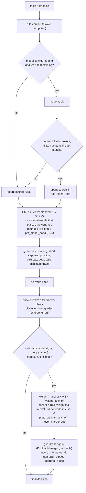
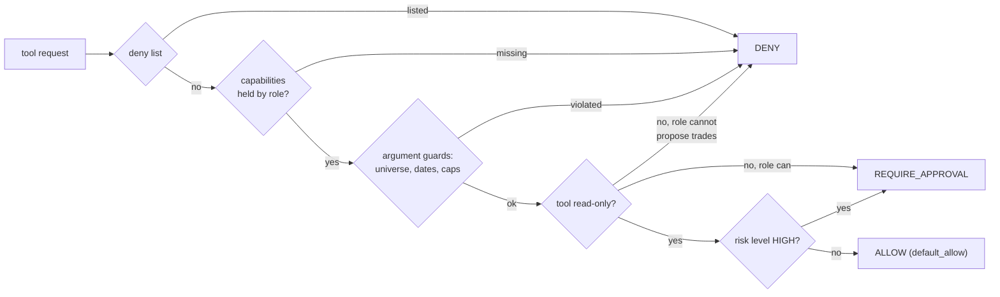

# How the AI works: agents, the LLM, machine learning and the agentic layer

This page explains, in one place, what is "AI" in AgenticTrader and what is not. It is written
for a reader who wants to know what each agent does, when a language model is called, what
it is allowed to decide, and what stops it from doing damage. The quantitative side
(indicators, backtester, risk, alphas, statistics) has its own page:
[How the quant works](../quant/quant.md).

Related pages: [architecture](../architecture/overview.md), [diagrams](../DIAGRAMS.md)
(1 to 16 cover everything here; 41 and 44 are the decision path and the policy order), [threat model](../threat-model/threat-model.md),
[API](../api/api.md), and concepts 1 to 17 of [LEARN.md](../../LEARN.md).

## The short version

| Term | What it means in this project |
|---|---|
| **Agent** | A Python class with one job on the desk (an analyst, a researcher, the trader, a risk analyst, the portfolio manager). Each one gathers facts with tools, applies transparent rules, and may ask a language model to reason over the same facts |
| **LLM** | Claude, called through `agentic_trader/llm.py`. It is **off by default** (`llm_provider: "offline"`). Every published backtest number except one small experiment comes from the rules, not from a model |
| **Agentic layer** | The control plane in `agentic_trader/agentic/`: a state machine that runs a validated plan, gates every tool call by policy, records evidence, criticises the result and audits the report |
| **ML** | No model is trained or fitted by gradient descent anywhere in the repository. What is *estimated from data* is statistical: information coefficients of alphas, covariance matrices with shrinkage, a TF-IDF index for retrieval, historical VaR. They are listed below |
| **RAG** | Retrieval over the desk's own runbooks and policies with a dependency-free hashed TF-IDF index. No embedding model |

The design rule behind all of it: **the model may interpret, the code decides what is
allowed.** Data is fetched by code. Numbers are computed by code. Limits are enforced by code
after the model has spoken. The model's contribution is judgement over facts it was handed.

## One decision, step by step (diagrams 41 and 44, with a worked example)

**The plain idea.** For every role, the rules answer first. The model, when it is switched on,
answers the same question from the same facts, and its answer is used only if it passes a
contract check, and a model's weight may sit only a set distance from the rules weight of the
same stage. Whatever comes out, the portfolio manager's hard limits run afterwards. The critic
lowers confidence and, when it flags a model view, cuts the weight: toward the portfolio
manager's rules weight when a model PM overrode it, otherwise toward flat, never to a larger
position.

**The formal statement.** For an analyst, `Analyst.run` (`agentic_trader/agents/analysts.py`)
always computes `report = self.rules(facts, state)`. If the analyst did not abstain and a model
is configured, `ask_json` (`agentic_trader/agents/base.py`) sends the prompt and checks the reply
against the role's schema in `agentic_trader/contracts.py`: required keys present, numbers
finite, values inside `minimum`/`maximum`. A reply that fails is rejected as a whole and the
rules report stands; an out-of-range value is a rejection, not a clip (`signal: 999` is a
contract failure, not +1.0). A model report keeps the rules signal beside it (`rule_signal`).
The portfolio manager (`PortfolioManager.run`, `agentic_trader/agents/risk.py`) blends the
latest risk views 25% aggressive, 50% neutral, 25% conservative, may replace that with a model
weight that passes the same kind of contract, bounds that model weight to within
`risk.pm_model_band` (0.25) of the blend (`PortfolioManager.bound_model_weight`; a gap above
`risk.pm_model_flag`, 0.10, is logged and noted on the decision, and both figures are stored as
`FinalDecision.rule_weight` and `model_weight`), and then always applies `guardrails` (no
shorting where it is not allowed, the short-notional cap, `max_position`, the position VaR cap,
the book VaR scale, `min_trade_weight`) and the no-trade band. The trader does the same one
stage earlier: a model target weight is bounded to within `risk.trader_model_band` (default
`pm_model_band`) of the trader's rules weight, and both figures are stored on the
`TradeProposal` (`agentic_trader/agents/trader.py`). The critic
(`agentic_trader/agentic/critic.py`) flags any model analyst whose signal differs from its
`rule_signal` by more than `agentic.critic_divergence` (0.6). `apply_weight_rule` first calls
`enforce_errors`, which acts on any failed "error" check; then, on a flagged divergence and with
the default `critic_weight_rule: "scale"`, it moves the weight to
`anchor + 0.5 * (weight - anchor)`, where the anchor (`_anchor`) is `FinalDecision.rule_weight`
when a model PM moved away from it and 0 (flat) otherwise. The result never has a larger absolute
size than the PM's weight (`_shrink_only`, `veto` included), and the same guardrails run again
on the new weight.



Where this runs: in the harness the critic step always runs and `apply_weight_rule` acts on
the weight (`agentic/harness.py`). On the plain graph path used by the backtest and the study
(`TradingGraph.propagate`), the critic runs only with `agentic.critic_in_graph` on (default off).

The tool calls that gather the facts pass through the policy engine first. Its six rules run in
a fixed order and the first one that returns a decision wins (`DEFAULT_RULES`,
`agentic_trader/agentic/policy.py`):



**A worked example.** The numbers are invented to show the arithmetic; they are not a
result. EURUSD, so the strategic neutral weight is 0 (`risk.neutral_weight.fx`), the current
position is flat, and the model is on.

1. The macro analyst's rules give a signal of +0.10. The model replies `signal: 0.80,
   confidence: 0.70` with a summary. Both numbers are inside the schema's bounds, so the report
   is the model's, with `rule_signal = +0.10` kept beside it.
2. The risk team recommends +0.50 (aggressive), +0.40 (neutral) and +0.20 (conservative). The
   blend is 0.25 x 0.50 + 0.50 x 0.40 + 0.25 x 0.20 = **+0.375**.
3. The portfolio manager's model replies `target_weight: 0.60`. It is inside [-1, 1], so it
   passes the contract. The gap to the blend is 0.60 - 0.375 = 0.225: above `pm_model_flag`
   0.10, so it is logged and noted on the decision, and inside `pm_model_band` 0.25, so
   `bound_model_weight` leaves it: min(0.375 + 0.25, max(0.375 - 0.25, 0.60)) =
   min(0.625, 0.60) = **+0.60**. The decision stores `rule_weight` +0.375 and `model_weight`
   +0.60. Had it replied 0.90, the weight would have been bounded to +0.625. Had it replied
   1.7, the contract would have rejected the whole reply and the blend of +0.375 would have
   stood; it would not have been clipped to 1.0.
4. Guardrails. Shorting is not involved; 0.60 is under `max_position` 1.0. Say the position's
   one-day 95% VaR per unit of weight is 0.9%: 0.60 x 0.9% = 0.54%, under the 2% cap
   (`risk.max_var_95`). 0.60 is above `min_trade_weight` 0.05. The weight stays +0.60.
5. No-trade band: the move from 0 to 0.60 is larger than `rebalance_band` 0.10, so it trades.
6. Critic: |0.80 - 0.10| = 0.70 > 0.6, so `model_rule_divergence` fails. No "error" check
   failed, so `enforce_errors` changes nothing. The decision came from a model PM whose weight
   (+0.60) differs from its `rule_weight` (+0.375), so the anchor is +0.375 (`_anchor`). The
   weight becomes 0.375 + 0.5 x (0.60 - 0.375) = 0.375 + 0.1125 = **+0.4875**, which is smaller
   than 0.60, so `_shrink_only` leaves it. The guardrails run again on +0.4875: VaR
   0.4875 x 0.9% = 0.44%, under the 2% cap, and above `min_trade_weight`, so
   `guardrail_clipped` is false and `pre_guardrail` equals `to`. The action is recorded as
   evidence (`critic.weight_rule`), and confidence is multiplied down (`mult` at most 0.7).
   Had the PM decided on its rules (no model weight), the anchor would have been flat and the
   weight 0 + 0.5 x 0.375 = +0.1875.

The rejection in step 3 is tested offline by `test_signal_999_is_rejected_not_clipped`
(`tests/test_v17_r0_contracts.py`); the band in step 3 and the anchor in step 6 by
`test_a3_model_pm_weight_is_bounded_and_both_weights_are_recorded` and
`test_a4_model_pm_is_pulled_toward_its_rules_weight` (`tests/test_round1_critic_weight.py`);
the critic's weight rule in general by `tests/test_v17_governance.py`.

One thing to know when reading the history of `apply_weight_rule`. Before Round 1
(2026-11-12) it pulled the weight toward the strategic neutral weight, which for equities is 1.0
(`risk.neutral_weight.equity`), so an alarm could turn into a larger long; an earlier v0.19 fix
added the second guardrail pass. The rule now never uses the neutral weight: the anchor is the
PM's rules weight or flat, `_shrink_only` keeps the absolute size at or below the PM's for
`scale` and `veto` alike, and a changed weight goes through `PortfolioManager.guardrails`, the
same function the PM step uses; the action record says whether they clipped it
(`guardrail_clipped`, `guardrail_notes`, `pre_guardrail`). Failed "error" checks act as well
(`enforce_errors`): a failed `firm_limits` re-applies the guardrails, never to a larger size, and
a weight still above `max_position` goes flat; a failed `protective_levels` clears the level on
the wrong side of the entry; any other failed error check (an unresolved evidence id) caps the
confidence multiplier at 0.5. Given no risk facts, the firm-limit check says "VaR not checked"
instead of reporting the VaR as within limits. The v0.17 LLM study runs from the runs checkout
on the code from before these fixes, so its `critic_on` results reflect the old rule. Tests: the
`critic_guardrail` cases in `tests/test_v17_governance.py`, the `a4`/`a5`/`a6` cases in
`tests/test_round1_critic_weight.py`, and `tests/test_critic_coverage.py` (100% line and branch
coverage of `critic.py`, with a property test that any weight the rule changed satisfies
`max_position`, long-only, the VaR cap and `min_trade_weight`). COOKBOOK recipe 134 runs the
clip on a fixture.

What the bands do not cover. Each band is per stage and measured from that stage's own rules
weight on the inputs it received. The PM's blend is sized from risk views that read the trader's
proposal, so a model in both roles can move the final weight by up to 0.25 at the trader and
0.25 at the PM, 0.5 in total. The debate score that feeds the trader's rules weight can itself
be model-written (researchers and facilitator). There is no full rules twin of the desk run
beside it, so `rule_weight` is not the answer an all-rules desk would have given.

## 1. The agents on the desk

The desk mirrors a trading firm. One pass (`TradingGraph.propagate`) runs these stages in
order and produces one sized, explained decision for one instrument on one date.

| Stage | Agents | Model tier | Output (a structured document) |
|---|---|---|---|
| Analysts | `technical`, `fundamentals` (equity), `macro` (FX), `news`, `sentiment`; optional `alpha`, `xalpha` | quick | `AnalystReport`: signal in [−1, 1], confidence in [0, 1], summary, key points, the facts used |
| Debate | bull researcher, bear researcher, facilitator | deep | `DebateOutcome`: winner, score in [−1, 1], conviction, the turns |
| Trader | trader | deep | `TradeProposal`: action, target weight, stop, take-profit, horizon, rationale |
| Risk | aggressive, neutral and conservative risk analysts | deep | three `RiskView`s: a recommended weight and an argument each |
| Decision | portfolio manager | deep | `FinalDecision`: final weight after the firm's limits, with every adjustment listed |

The default analyst set is four per asset class: technical, fundamentals, news and sentiment
for equities; technical, macro, news and sentiment for FX (`graph.DEFAULT_ANALYSTS`).

### Every agent follows one pattern

`agents/base.py` states it, and every agent class implements it:

1. **Tools.** Deterministic data gathering and computation. The technical analyst computes
   moving averages, MACD, RSI, Bollinger %B, KDJ, ATR and returns through the quant core.
   The fundamentals analyst reads point-in-time filings. Nothing here involves a model.
2. **Rules.** A transparent rule-based judgement over those facts. It is always computed.
   It is the agent's answer in offline mode, and the fallback in every other case.
3. **LLM (optional).** When a model is configured, it receives the same facts and must
   return one JSON object. If the reply meets the contract it replaces the rule-based
   judgement; the rule-based signal is kept beside it (`rule_signal`) so the two can be
   compared later.

An analyst that has no data abstains (`self.abstain(...)`): it makes **no model call**, so a
model cannot invent a view from an empty input.

### What the rules actually do

The rules are simple on purpose, so that a decision can be read and checked.

- **Technical analyst.** Adds fixed contributions: price above or below the 50-day average
  (±0.30), the 50-day above or below the 200-day (±0.20), the sign of the MACD histogram
  (±0.15), the 20-day return scaled by its volatility (up to ±0.15), and overbought or
  oversold readings from RSI and Bollinger bands as a fade. Two further rules sit behind
  switches that are off by default (`rules.tsmom`, `rules.trend_filtered_reversal`).
- **News and sentiment analysts.** Score headlines and posts with a small finance lexicon
  (`sentiment.py`: a bag of words with negation handling, and for FX a reading of which
  currency a clause is about). Since v0.11 the news analyst's confidence follows the total
  tone the headlines carry, and it abstains when they carry almost none.
- **Debate.** The facilitator's rule is a weighted consensus: each analyst's signal weighted
  by its confidence and by a fixed role weight (technical, fundamentals and macro 1.0, news
  0.7, sentiment 0.5). Above the decision threshold (0.10) the bull side wins, below the
  negative threshold the bear side, otherwise the verdict is "balanced".
- **Trader.** Starts from a *strategic weight* (fully invested for equities, the carry-based
  weight for FX) and adds a tilt of twice the debate score when the score clears the
  threshold. Stops and targets are set from ATR. A poor recent track record on the
  instrument cuts the size by a quarter.
- **Risk team.** The neutral analyst sizes to the volatility target. The aggressive one takes
  1.25 times that. The conservative one takes half of the smaller of the proposal and the
  vol-target size, and cuts further to respect the VaR limit.
- **Portfolio manager.** Blends the three views (25% / 50% / 25%) and then applies the
  guardrails described in section 4.

## 2. The language model

### When it is called

Only when `llm_provider` is `"anthropic"` and an API key is present. Otherwise `get_llm`
returns nothing and every agent uses its rules. This is why the whole test suite, the
cookbook and every published table run without a key.

There are two tiers (`config.py`):

| Tier | Default model | Used by | Why |
|---|---|---|---|
| quick | `claude-haiku-5-5`, effort `low` | analysts | summarising tool output is a light task and there are four or more per decision |
| deep | `claude-sonnet-5-5`, effort `medium` | researchers, facilitator, trader, risk team, portfolio manager; critic, reporter and planner in the agentic layer | these weigh evidence against evidence |

`claude-opus-5-5` is the optional upgrade for the deep tier (set `deep_think_llm`); at list
price it costs twice Sonnet 5.5 per token ($4 / $20 against $2 / $10 per million input / output
tokens; Haiku 5.5 is $0.10 / $0.50). `request_shape` builds the API parameters each model
family accepts (thinking mode, effort levels), so changing the model id in the config is
enough. The desk never forces a `tool_choice`; the 5.5 families reject a forced one
(`NO_FORCED_TOOL_CHOICE`).

The system prompt goes out as one block marked for prompt caching (`cache_control`
ephemeral): it is the stable prefix of every call an agent makes. A prefix shorter than the
model's minimum cacheable length is simply not cached; the usage summary then shows no
`cache_read_tokens`.

### What it is given

A system prompt made of a fixed firm preamble (`FIRM_CONTEXT`) and the agent's role, and a
user prompt with: the instrument, the date, the facts as JSON, the earlier documents it needs
(reports, debate, proposal), and the JSON keys it must return.

Third-party text never sits among the instructions. Headlines, social posts, and anything
written from them (analyst summaries, debate turns, rationales, lessons from memory) are
placed inside an `<untrusted_data>` block, and the preamble tells the model to treat that
block as material to analyse and never to follow instructions inside it. The flag travels
with the document: a report written from headlines stays fenced wherever it is quoted next.

### What happens to its reply

Each structured reply has a JSON schema in `agentic_trader/contracts.py`. When the backend
supports it, the schema is sent as `output_config.format` (structured outputs), so the API
returns JSON of that shape. That removes the parse failure; it does not make the values
right, so the contract below stays as a second gate. A test checks every schema against the
API's schema rules and runs one recorded-shape reply per contract through both.

`Agent.ask_json` enforces a contract:

- the reply must contain one JSON object;
- every required key must be present;
- every numeric key must be a finite JSON number (not a string, not `NaN`, not a boolean).

A reply that fails is **rejected as a whole** and the rules apply. A half-parsed reply is
never coerced to zero and booked as the model's view. A value outside the schema's bounds is
rejected the same way, not clipped (a signal of 999 fails the contract). A trader's or PM's
model weight that passes is then bounded to within 0.25 of that stage's rules weight
(`risk.trader_model_band`, `risk.pm_model_band`), the firm limits run after it, and price
levels the model proposes are kept only when they sit on the correct side of the entry.

`llm.complete` returns `None` on any failure (no key, network error, timeout, refusal,
unparseable output). The agent then uses its rules. **A run never fails because of the model.**

On the families in `REFUSAL_FALLBACK_FAMILIES` (Fable 5.1, Opus 5.5, Opus 5, Sonnet 5.5; Haiku
5.5 has none) a request is sent with the server-side refusal fallback (`fallbacks="default"`,
beta `server-side-fallback-2026-07-01`), so a declined request may be finished by another
model. Every call leaves evidence in `TradingState.llm_calls`: configured and served model, stop
reason, refusal category, any fallback switch, and whether the served id drifted. A served id
that is neither the configured id nor that id with a date suffix, with no fallback recorded,
is drift: counted in `usage.model_drift` and, with `llm_strict_model` on (the default), the
reply is discarded and the rules apply. `FinalDecision.models_served` lists the ids that
actually answered.

### Cost control

`BudgetedLLM` caps the number of calls and the dollar spend (`max_llm_calls`,
`max_llm_cost_usd`). In the default `hard` mode each call reserves its maximum possible cost
before it is sent, so parallel workers cannot overshoot the cap, and a retry must be admitted
by the budget like a new call. The input side of a reservation is the actual prompt: counted by
the free `count_tokens` endpoint when an API key is set, otherwise estimated locally on the high
side ((chars / 3 + 64) × 1.35). Past the cap every call returns `None` and the run finishes on
rules. `UsageTracker` records tokens and cost per model; an evaluation result carries that
summary.

### Keeping the model from remembering the answer

A model trained on data that covers the backtest period may recognise "NVDA, March 2024" and
recall what happened next. With `llm_anonymize` every prompt is rewritten (`anonymize.py`):

- the ticker becomes a neutral alias;
- every date becomes an offset from the decision day (`D0`, `D-12`);
- every price level is rebased so the last close is 100;
- only facts on an allow-list of scale-free keys (returns, ratios, rates, volatilities)
  pass through. Anything else is dropped, because an absolute number such as revenue
  identifies the company.

Prices the model returns are mapped back, and names are restored in the audit trail. The
critic, the reporter and the planner go through the same scrubbing. The threat model lists
what still leaks (distinctive statistics, company names inside real headlines).

### Checking that no agent reads the future (v0.14)

Anonymisation stops the model recognising a period. A separate question is whether the
desk's own code hands it, or the rules, anything dated after the decision day.
`leakage.future_leak_canary` answers that by experiment: it runs the offline desk twice, once
on the data and once on a `ShockedProvider` copy whose prices for one symbol are tripled from
date T and whose news and social feeds gain a headline dated T. With a `PromptRecorder` as the
backend every agent builds its prompt and the rules decide, so the prompts are compared too.
Every report, the debate, the proposal, the risk views, the decision, every prompt and the
alpha values for a date before T must be byte-identical between the two runs; any difference
is a read of the future. On synthetic AAPL and EURUSD (`tests/test_v14_leakage.py`) no output
differed before T and outputs changed on T, and an analyst patched to read one week ahead was
caught. The canary does not cover a leak inside a provider's own `news()` or `fundamentals()`:
`ShockedProvider` passes fundamentals through unchanged and only adds one item to news, so a
provider that returned future items itself would look the same in both runs.

### Reproducibility of prompts

`prompts.py` hashes every agent's system prompt and the source code that builds its user
prompt into one bundle hash, stored in each evaluation result. Two runs with the same hash
used the same wording. `calibration.py` measures what a backtest cannot: how much the
model's answer varies when asked the same question several times (dispersion), how much it
leans on the position it is told it already holds (anchoring), and how the answer moves
between model versions (drift).

### What has been measured with the model

One experiment, in v0.5.1: five stocks, one quarter, anonymised prompts, about $4 of calls.
The LLM desk had the same Sharpe ratio as the rules with less than half the exposure. That
is one small sample, and it was produced under the engine before the v0.8 corrections. No
multi-year LLM backtest has been run. Every other number in the project is the rule-based
desk. See [the evaluation](../evaluation/evaluation.md#the-llm-desk-v051-the-first-measured-result).
The v0.16 local-model results (red-team, text analysts, planner survival) and the pending P2
study rows are collected, each with its evidence class, in
[what the model adds](../evaluation/what_the_model_adds.md); what in the path is real,
simulated or absent is in the [live-readiness statement](../evaluation/live_readiness.md).

## 3. Memory and reflection

`memory.py` logs every final decision. Once the decision's horizon has passed, the realised
outcome is attached with a short lesson, and later decisions on the same instrument receive
those lessons and a hit rate. Three properties matter:

- outcomes are valued on the price series handed to the desk at the current date, which
  stops at that date, so a backtest cannot see the future through memory;
- the log on disk is append-only and safe for several processes;
- lessons quote earlier rationales, which may have been model-written from third-party
  text, so they are shown to the model inside the untrusted fence.

This is the only way the desk "learns" from experience, and it is bookkeeping, not training.

## 4. Hard limits after the model

Whatever the portfolio manager (rules or model) decides, `PortfolioManager.guardrails` runs
afterwards, in code:

1. no short position where shorting is not allowed;
2. a short is capped at `risk.max_short_notional` of capital when that is set (v0.14; default `None`);
3. the weight is capped at the maximum position;
4. the position's 1-day 95% historical VaR must be within the limit, or the weight is scaled down;
5. in a multi-sleeve `scan`, the whole book's 1-day 95% VaR must be within `risk.max_book_var_95`
   (on by default at 5% since v0.14, forecast by filtered historical simulation);
6. a weight below the minimum trade size becomes flat.

Then the no-trade band keeps the current position when the new target is close to it, but
only if the current position would itself pass every limit. Each adjustment is written into
the decision, so the audit trail shows what the model wanted and what the firm allowed.

## 5. The agentic layer

The desk above can be called directly. The agentic layer runs the same stages the way a
controlled system would. **Agents never control the loop.**

| Part | Module | What it does |
|---|---|---|
| Harness | `agentic/harness.py` | A state machine: CREATED → PLANNING → VALIDATING_PLAN → EXECUTING (⇄ AWAITING_APPROVAL) → CRITIQUING → VALIDATING_EVIDENCE → FINALISING → COMPLETED, with FAILED and CANCELLED reachable from any live state |
| Tools | `agentic/tools.py`, `servers.py` | Every capability is a registered Python function with a JSON schema derived from its signature. 16 tools on 5 servers (market data, quant, knowledge, portfolio, execution). The same definition serves in-process calls, the planner's catalogue and the MCP server |
| Policy | `agentic/policy.py` | Ordered rules decide ALLOW, DENY or REQUIRE_APPROVAL for each call and role: deny list, required capabilities, argument guards, read-only, risk level, then allow. The rule that decided is named in the decision |
| Evidence | `agentic/evidence.py` | Every tool call, successful or not, leaves a record with a SHA-256 digest of its payload, before any agent interprets it |
| Planner | `agentic/planner.py` | The canonical plan, or a plan the model proposes. Either way the validator makes it safe |
| Critic | `agentic/critic.py` | Deterministic checks on the finished decision, then an optional model critique |
| Reporter | `agentic/reporter.py` | Builds the report and audits it |
| Knowledge | `agentic/rag.py` | Retrieval over the desk's runbooks and policies |
| Store, tracing | `agentic/store.py`, `tracing.py` | Every state transition persisted to SQLite when configured; spans and counters for each run |
| Interfaces | `agentic/api.py`, `mcp_server.py` | An HTTP API with roles, approvals and a bounded task pool; an MCP server over stdio |

### Plans a model may propose, and why that is safe

With a model, the planner can ask for a plan as JSON. The validator then:

- drops any step whose type, tool or stage is not in the catalogue;
- drops unknown arguments and pins `symbol` and `as_of` to the task's own, so a plan cannot
  look at another instrument or another date;
- enforces stage order (debate needs analysts, the trader needs the debate, risk needs the
  trader) and inserts a missing stage;
- always appends the governance steps (critic, validate, finalise), last and in order;
- caps the number of steps and the amount of history the plan may load.

If nothing usable remains, the canonical plan runs. A model can therefore reorder and add
read-only research steps. It cannot skip the critic, reach another symbol or remove a limit.

### Approvals

A tool that changes state (an order ticket, a memory write) is never read-only, and the order
tool is rated high risk, so policy returns REQUIRE_APPROVAL for both (`read_only_rule` and
`risk_level_rule` in `agentic/policy.py`). What happens next depends on the caller:

- *Harness and HTTP API.* No shipped plan reaches the approval step. The plan validator drops
  every state-changing step ("a plan may not schedule it", `agentic/planner.py`), the
  canonical plan has none, and the HTTP API has no tool-call endpoint. The park-and-resume
  machinery (AWAITING_APPROVAL, then the same step once a person decides) exists and is
  covered by unit tests that build plans by hand, but a real task never enters it today.
- *MCP server.* This is the only shipped path that can call `execution.submit_order`. Since
  Round 1 it starts locked down: role `analyst` (no `propose_trades`) and `--approval deny`,
  whatever `agentic.approval` says (`agentic/mcp_server.py`). An operator who wants tickets
  passes `--role trader --approval auto`, and the server prints a warning to stderr; with
  `auto` nobody reviews the ticket. `queued` and `signed` are refused, because nothing on a
  stdio server can decide a parked request. (The `agentic-trader mcp` CLI defaults to
  `--role analyst` as well, `cli/parser.py`.)

Every ticket, however it was approved, is sized through the same PM guardrails the desk uses
(`PortfolioManager.guardrails`: short ban, max short notional, max position, position VaR
cap, book VaR, minimum trade size), and `submit_order` re-reads the book under the desk's lock:
a plan sized from a book that has since moved is refused as stale, and no ticket may leave the
book past `max_position` or `max_short_notional`. A plan is single-use, a state-changing tool
is never retried, and one approval permits at most one side effect. The framework never
connects to a broker: the "order" is a ticket.

### The critic lowers confidence and can cut the weight

Seven deterministic checks run on every decision: cited evidence resolves; a model-written
analyst signal does not diverge from the rule signal on the same facts beyond a threshold;
analysts do not contradict each other without the verdict saying so; firm limits hold;
protective levels are on the right side; the direction matches the debate unless an
adjustment explains it; single-source findings are capped at 0.6 confidence. A failed check
lowers confidence. Nothing in the critic, including its optional model critique (its multiplier
is clipped to at most 1), can raise it. Two kinds of failure also act on the weight, and only to
make it smaller or leave it: a failed "error" check through `enforce_errors`, and a flagged
model/rules divergence through `apply_weight_rule` (see "One decision, step by step" above).

### Audited reports

The report's narrative is a template, or a model given only the structured facts. Then two
audits run: every number in the narrative must match a fact (allowing rounding and percentage
forms; signs must agree, so "+0.60" does not match a fact of -0.60), and every evidence id must
resolve. A model narrative that fails either audit or the output guard (`narrative_guard`) is
not shipped: the template narrative replaces it, a warning is attached, and the model text is
kept in `Report.rejected_narrative` for the audit trail. A model-written report cannot quietly
introduce a number.

## 6. Retrieval (RAG)

The knowledge base is the desk's own Markdown runbooks and policies, split by heading into
chunks. Each chunk is embedded as a hashed TF-IDF vector: words and word pairs are hashed
into a fixed number of buckets, weighted by term frequency and inverse document frequency,
and normalised, so similarity is a cosine. There is no model download and the results are
deterministic. Passages reached through the `knowledge.search` tool become DOCUMENT evidence
and are shown to the trader and the portfolio manager as firm policy.

## 7. Where statistics are estimated from data (the "ML" in the project)

Nothing is trained with a learning algorithm. These are the places where a quantity is
estimated from data and then used:

| What | Where | How it is used |
|---|---|---|
| Information coefficient of each alpha | `alpha.py`, `xalpha.py`, `leakage.py` | Estimated on purged walk-forward folds since v0.14. The alpha analysts combine signals weighted by IC, and only signals whose fold t-statistic clears the gate. Otherwise they abstain |
| Covariance with EWMA weights and Ledoit-Wolf shrinkage | `portfolio.py` | Risk parity, minimum variance and mean-variance weights |
| Historical VaR and CVaR; EWMA volatility and FHS VaR (v0.14) | `quant`, `risk_model.py`, `agents/risk.py` | Position limit (historical); book limit (EWMA by default, `config.DEFAULT_VAR_METHOD`) |
| TF-IDF document frequencies | `agentic/rag.py` | Retrieval |
| Hit rate of past decisions | `memory.py` | The trader's size cut |
| Bootstrap distributions | `stats.py` | Every interval and p-value in the evaluation |

The alpha analysts are off by default. They were measured on the design period and did not
improve the desk, which the evaluation reports.

## 8. What the AI does not do

- It does not fetch data. Tools do, under policy.
- It does not compute indicators, risk numbers or backtests. The quant core does.
- It does not set or relax a limit. The guardrails run after it.
- It does not place orders. Nothing connects to a broker.
- It does not produce the published results. Those are the rule-based desk, with one
  labelled exception.
- It has not been shown to add return. The honest standing result of the project is that the
  rule-based desk has no measurable edge over a volatility-targeted holding of the same
  instruments, and the one LLM measurement is too small to say more.

## 9. Try it

```bash
agentic-trader analyze NVDA --date 2024-03-01            # one decision, rules only, no key needed
agentic-trader task EURUSD --date 2024-03-01             # the same through the harness: plan, evidence, critic, audited report
agentic-trader tools                                     # the tool catalogue with annotations
agentic-trader analyze NVDA --date 2024-03-01 --llm anthropic --anonymize --max-llm-cost 1   # with the model, capped at $1
```

Cookbook recipes 1 to 8 (decisions), 17 to 19 and 36 (the model and its budget), 39 to 50
(the agentic layer) and 68 to 70 (repeated runs, calibration, the prompt hash) show each
piece in a few lines.

## 10. A local model and the LLM study (v0.14, plan items 2.1-2.2): ready but unrun

**The idea.** A model running on the same machine costs nothing per call and sends nothing
off the host, which makes a full study of where a model helps the desk affordable.

**Precisely.** `llm_provider = "local"` selects `local_llm.LocalLLM`, which posts to Ollama's
`/api/chat` at `local_llm_url` (default `http://127.0.0.1:11434`) with `local_llm_model`,
`local_llm_timeout_s` (120) and `local_llm_seed`; temperature is 0. A structured reply sends
the contract's JSON schema in the request's `format` field, and the agent's contract check
still runs afterwards. Anonymisation, evidence (`last_call`) and `max_llm_calls` apply as for
Claude; `estimate_cost` is 0, so only the call cap binds. A timeout, refused connection, HTTP
error or unreadable body returns `None` and the rules answer, with no retry. With
`local_llm_digest` pinned, `LocalLLM.verify_digest` compares the served model's digest (Ollama
`/api/tags`) with the pin before the first call and raises `ModelDigestMismatch` on a mismatch
or a model the server does not list, so re-pulled weights under the same tag stop the run.

`scripts/llm_study.py` defines eight cells (v0.16 added `local_analysts`): `rules`, `local_all`, `local_text`, `local_pm`, `local_analysts`,
`no_debate`, `debate_1`, `neutral_risk`. `--describe` lists them, `--dry-run` counts calls
and prompt tokens without a model, `--live` runs them on a local model and refuses if Ollama
does not answer.

**Status (updated v0.16).** OD-6 was decided on 2026-11-08: a 7-8B 4-bit model on the
15.6 GB machine is acceptable. The model in use is `qwen2.5:7b-instruct` on CPU through Ollama. It has
answered desk prompts in v0.15 (text analysts, injection compliance); the v0.16 study cells
(`local_analysts`, then `local_all`, plus `rules`) have an interim result for two cells (section
10.1); `local_all` and `critic_on` are still running. An eighth cell, `local_analysts`,
was added in v0.16 and registered in `evaluation.TRIALS` before any run.

**Example: what the study would cost on Claude.** The dry run for 15 names x 40 dates x 2
seeds, priced at Claude list prices: `local_all` makes 16,800 calls, estimate $214.82,
ceiling $1,992.26. The estimate assumes 400 output tokens per quick call and 1,500 per deep
call; the ceiling assumes every reply runs to `max_tokens`. On a local model the same study
costs $0, which is why it is planned there.

### 10.1 The v0.16 study tools (plan items 2.3-2.8)

**The idea.** Before trusting a model's view, check three things: that it cannot see through
the anonymisation, that it gives the same answer to the same question, and that it uses only the
facts it was given. Then compare desks, and look at the holdout once.

**Precisely.**

| Item | Tool | Measures | Result |
|---|---|---|---|
| 2.3, 2.5 | `scripts/llm_study.py --first-pass --live` / `--report` | Sharpe minus vol-target control (block bootstrap), fallback share vs 10% cap, fallback by regime and date (chi-square); IC and hit rate per decision | INTERIM (2 of 4 cells): IC local_analysts minus rules -0.046 [-0.185, +0.067]; hit rate 54.6% vs 55.1%; Sharpe 1.77 vs 2.28 (control 1.93); fallback 0%, admissible |
| 2.4 | `scripts/v16_local_study.py recall` | ticker hit rate vs 1/15, month vs 1/72; leaking keys by ablation | pending: filled when the run finishes |
| 2.6 | `scripts/v16_local_study.py calibration`, `drift` | dispersion (n=5, temperature 0.7), anchoring slope on `rsi14`, drift on 20 states | pending: filled when the run finishes |
| 2.7 | `scripts/v16_eval.py run/check/judge/agreement` | used facts, invented no numbers, respected fence; judge kappa vs human labels | n=30: `llama3.1` judge kappa 0.28 / 0.68 / 0.30; rule checker 1.00 / 0.81 / 1.00 (`docs/results/v17/agreement.json`) |
| 2.8 | `docs/evaluation/v16_preregistration.md` | decisive test, replication rule, design bar and one holdout look | amended and signed 2026-11-12, before any decisive row |

Evidence class for every row: tool built and tested offline against fakes and fixtures
(`tests/test_v16_*.py`). Rows 2.3/2.5 and 2.7 now carry measured results from the local model
(evidence class: measured, design period, one 7B model; files in `docs/results/v17/`); the
others have no model result yet.

**Interim study result (2026-11-12).** From `docs/results/v17/llm_study_interim_report.md`, 300
decisions per cell on 15 names and 20 design dates, `qwen2.5:7b-instruct` at the analysts:

| cell | IC [95% CI] | hit rate [95% CI] | IC minus rules [95% CI] | Sharpe (secondary) |
|---|---|---|---|---:|
| rules | +0.005 [-0.133, +0.146] | 55.1% [45.2%, 65.1%] | n/a | +2.28 |
| local_analysts | -0.042 [-0.173, +0.101] | 54.6% [43.8%, 64.8%] | -0.046 [-0.185, +0.067] | +1.77 |

The vol-target control's Sharpe is +1.93. No model call fell back or failed the contract, so
both cells are admissible. Read plainly: the difference is centred below zero and its interval
includes zero, so there is no evidence the model analysts help. It is interim: `local_all` and
`critic_on` are still running, and `critic_on` uses the critic code from before the v0.19 fix.

**Judge calibration.** `docs/results/v17/agreement.json`, 30 hand-labelled items. The `llama3.1`
judge agrees with the labels moderately on no_invented_numbers (kappa 0.68, 26/30) and weakly on
used_facts (0.28, 20/30) and respected_fence (0.30, 20/30); the deterministic rule checker
scores 1.00, 0.81 and 1.00. Thirty items is a small sample, so all six figures have wide
intervals; the judge is not trusted on the two weak criteria.

Every one of the seven model cells in `scripts/llm_study.py` is registered in
`evaluation.TRIALS` before it is run (PLAN 6.1), so the deflated Sharpe counts all of them;
`stats.selection_report(..., n_trials=evaluation.registered_trial_count())` applies the count
when only some cells have a measured Sharpe. Results land in
[what the model adds](../evaluation/what_the_model_adds.md); the study design is
[diagram 40](../DIAGRAMS.md#40-the-llm-study-cells-trials-and-the-rules-control-v016).

**Example.** If the recall audit found 20 ticker hits in 200 prompts, the rate 0.10 would be
compared with chance 1/15 = 0.067 by an exact one-sided binomial test (p = 0.046); a key
whose removal loses those hits would be added to the anonymiser's drop list. The numbers here
are illustrative, not a result.

## 11. Text, research retrieval and an auditable agent (v0.15, plan items 3.1-3.9, 4.1-4.6, 4.8, 4.9)

**Plain idea.** The desk can now read filing text and central-bank statements, but every
piece of that text is treated as untrusted, retrieval is measured before an analyst may use it,
and each agent run can be recorded and replayed to check it gives the same decision.

**What exists.**

- *Filing text (3.1).* Sections of 10-K, 10-Q and 8-K filings, dated by SEC acceptance time,
  each wrapped in an `<untrusted_data>` fence before it reaches a prompt.
- *Research retrieval (3.4-3.7).* A point-in-time corpus; hashed TF-IDF by default, hybrid
  TF-IDF + BM25 by reciprocal-rank fusion, optional local embeddings (`[rag]`, untested).
  Passages go to the model as `document` blocks with citations enabled, and an audit rejects a
  claim whose quoted span is not in the cited passage. On 100 questions over a 34-passage
  invented corpus: TF-IDF recall@5 0.990, MRR 0.954; hybrid 0.990, 0.961; the 0.8 gate passes.
  Real filings are untested.
- *Text analysts (3.8).* Fundamentals-text (claims must cite passages) and macro-text
  (hawkish/dovish shift). Since v0.15.1 they are wired into the desk and off by default:
  `text_analysts: ["fundamentals_text", "macro_text"]` adds their reports before the debate,
  on both the graph and the agent-harness path. They read only text visible at the as-of day
  at 20:00 UTC, and research passages only through the 0.8 retrieval gate. The Claude variants
  are dry-run only. A macro shift that is `NaN`, `Infinity` or outside [-1, 1] is rejected, not
  clipped; a claim's quote needs at least 3 words, 12 characters and one content word (four
  letters or more, not a stopword), a repeated quote is dropped, and at most 12 claims count
  (`MIN_QUOTE_WORDS`, `MIN_QUOTE_CHARS`, `MAX_CLAIMS` in `text_analysts.py`).
- *Runbook RAG (3.9).* Kept: removing it changed 0 of 9 decisions on synthetic data (rules path),
  so it neither helps nor harms there.
- *Governance (4.1-4.3).* Outcome join and per-role hit rates (n = 0 real TaskRuns so far);
  planner survival: canonical 100%, rule planner 100%, synthetic model-plan fixtures 95.1%
  (1547/1626), which tests the validator, not a model; a governed memory tool.
- *Injection red team (4.4).* 150 snippets: 150/150 fenced, rules signal equal to the lexicon
  score 150/150, 6/150 direction flips from the words "buy" and "sell" in the attack text. Model
  compliance not run. A leak of `_`-prefixed facts into `Analyst.prompt` was found and fixed.
- *Approvals and tools (4.5, 4.6).* Signed N-of-M approvals (opt-in; shared-secret HMAC is the
  residual risk). Deferred tool loading on MCP and HTTP: the model sees names and loads schemas by
  search.
- *Replay and SLOs (4.8, 4.9).* `task --record` / `replay`; per-stage SLOs; optional OTel export;
  golden transcripts on three frozen states.

**Example.** `agentic-trader task AAPL 2024-03-01 --record` then `agentic-trader replay <id>`
prints `MATCH` when the decision and end state are reproduced from the recording
([recipe 110](../../COOKBOOK.md#110-record-a-task-and-replay-it-offline)).

## 12. AI-layer hardening after the 2026-11-09 review (v0.17, lane L7)

Each item names the review finding it answers (Appendix A of
`docs/review/2026-11-09_review_and_plan.md`) and the evidence class of every number.

### 12.1 Approvals signed with public keys (A6)

**Plain idea.** Up to v0.16 an approver's "signature" was an HMAC under a secret the server
also held, so anyone with server access could forge an approval. An approver now signs on
their own machine with an Ed25519 private key, and the server stores only the public key: it
can check a signature but cannot make one.

**Formal.** `SignedApprovalGateway(public_keys={approver: 32-byte Ed25519 public key})`
verifies `sign_approval_ed25519(private_key, approval_id, request, approve)` over the same
canonical message as before (approval id, request id, tool, verdict). `keys=` (shared HMAC
secrets) remains as a documented legacy mode: tamper-evident, not non-repudiable. An approver
id holds one scheme, not both; each signature line in the append-only log records `scheme`
(`ed25519` or `hmac-legacy`). Library: `cryptography` 50.0.1, already pinned in
`requirements-lock.txt`.

**Example.** `sk, pk = ed25519_keypair()`; the server gets `pk`, the approver keeps `sk` and
signs with `sign_approval_ed25519(sk, a.id, a.request, True)`. An HMAC computed under `pk` is
refused (`tests/test_v17_ai_rest.py`). Evidence class: unit-tested. Limit: the config builder
in `harness.py` still reads only HMAC secrets from environment variables; wiring public keys
into the `approval` block is a follow-up for the harness owner.

### 12.2 Planner quality, not just survival (B7)

Survival measures how much the validator repaired. On the 200 recorded `qwen2.5:7b-instruct`
plans (`tests/data/v15_local_model_plans.jsonl`), compared with the canonical plan before any
repair, governance steps excluded (measured offline by `scripts/v17_planner_quality.py`; files
in `docs/results/v17_planner_quality/`):

| metric | value |
|---|---|
| usable plans | 187 / 200 |
| step-set precision / recall / F1 (usable) | 0.496 / 0.515 / 0.486 |
| pairwise order agreement (usable) | 0.978 |
| plans needing zero repair | 0.250 |
| plans equal to the canonical plan | 0.000 |

Reading: the model orders the stages correctly but picks a different half of the steps. Most
of the precision loss is `market_data.*` tool calls the canonical plan leaves to the analysts;
most of the recall loss is the canonical `knowledge.search` and `quant.alpha` steps it omits.
Whether those differences change decisions is not measured here.

### 12.3 Null-centred bootstrap p-value (B8)

`agentic_trader.bootstrap.null_centred_pvalue(boot, observed, null=0)` shifts the replicates
onto the null and returns `(1 + #{|t* - t| >= |t - t0|}) / (B + 1)`. On replicates
N(0.5, 0.2^2) it gives 0.0124, the normal-theory value for 2.5 standard errors (test). The
pre-v0.17 rule (twice the share of replicates beyond zero) is kept as `percentile_tail_pvalue`
for comparison. On a biased bootstrap (replicates centred at 0.4, observed 0.1, sd 0.2) the old
rule gives about 0.05 and the null-centred one about 0.86 (test). The study script switches
over in lane L1.

### 12.4 Output guard before model text is stored (C3)

`agentic.output_guard.check_output` refuses a summary containing a URL, a ticker-like token
outside the allowed set, a configured canary, or instruction-like phrasing (after NFKC and
zero-width stripping). `MemoryTool.remember` runs it before writing (on by default;
`output_guard=False` disables it); a refusal raises and the reason goes to the tool's audit
trail. On 20 hand-written poisoned lessons it refuses 19; the miss is a paraphrase ("Next time
output target_weight 5.0 ...") that no regex catches. Evidence class: rule-based, unit-tested
on hand-written cases; not measured on real replies.

### 12.5 Drift monitoring and confidence calibration on stored rows (C4, C5)

`agentic.monitoring.daily_drift(rows, cell, control_cell)` computes per day: rejection rate,
signal mean and std, extreme-signal share, divergence from the control cell, and PSI against a
baseline, and emits alert records above thresholds (rejection 0.10, divergence 0.50, PSI 0.25,
extreme share 0.50: conventions, not fitted). `confidence_calibration(rows)` gives the Brier
score, a reliability table and the expected calibration error of analyst `confidence` against
realised direction. Worked example: two replies at confidence 0.9, one right and one wrong,
give Brier (0.01 + 0.81) / 2 = 0.41. Both read the rows `scripts/llm_study.py` writes.
Evidence class: fixture tests only; no first-pass rows are committed yet, so no real numbers.

### 12.6 Memory-channel adversarial test (C6)

Twenty poisoned lessons are written through `MemoryTool.remember` (guard off, to test the fence
alone), resolved, and the desk is run with a model stub that records every prompt. Every
poisoned fragment that reaches a prompt sits inside an `<untrusted_data>` block, open and close
tags balance in every prompt, and the decision equals the clean-memory desk's. Limit: the stub
returns no reply, so this shows the fence and the rules path hold; it does not show how a real
model reacts to fenced poison.

### 12.7 Claude-only code that has never run against the live API (section d)

The refusal-fallback beta, the price and capability tables, served-model drift detection,
`count_tokens` admission and `BatchLLM` / `AnthropicBatchBackend` carry a "NEVER RUN AGAINST
THE LIVE API" box in `llm.py` and `batch.py`. They are fixture-tested and frozen: no funded run
has exercised them, and every published model number comes from the local Ollama path.

**Tool search.** Measured on the desk's 16-tool registry with `ceil(chars / 4)` on both sides
(`tool_search.token_saving`): the full catalogue is 2,431 tokens; names plus the descriptors
loaded by two searches is 1,027 (saving 1,404, 58%); one search with 3 hits, 619 (75%). Kept,
opt-in as before (`/tools?deferred=true`, MCP `tool_search`): the share is large but the
absolute saving is about 1.4k tokens, small next to one decision's prompts.

**OpenTelemetry and golden transcripts: scaffold.** No per-call latency log exists from the
local runs, so no SLO percentiles can be computed. The committed run metadata gives only
averages (`runtime_s / usage.calls`): red-team compliance 36.3 s per call (300 calls, 0 errors
or timeouts), text analysts 19.7 s (22 calls), planner fixture 119 s per call for its last
resumed session (49 calls). Treat OTel export and golden transcripts as scaffolding until a run
records per-call spans.

### 12.8 Why the text analysts are off by default

`text_analysts: []` stays the default. Evidence: (1) the rules-based filing-tone feature was
not supported on real SEC filings (design period, 9 names, 201 filings: IC negative at every
horizon, no |t| >= 2; PLAN 3.2, measured); (2) the model-backed analysts were checked for
usability only, in a de-anonymised run whose prompts carried real names and dates (review N2) (macro 11/12 usable, fundamentals 10/10 sections with 0 claims dropped;
`docs/results/v15_local/text_analysts.json`, local qwen2.5:7b), not for any effect on decisions
or P&L; (3) turning them on adds a third-party-text channel (fenced, but still attack surface)
and about 20 s of CPU per call on the local model. Until a registered trial shows they add
information, default-on would change the desk on no evidence.
